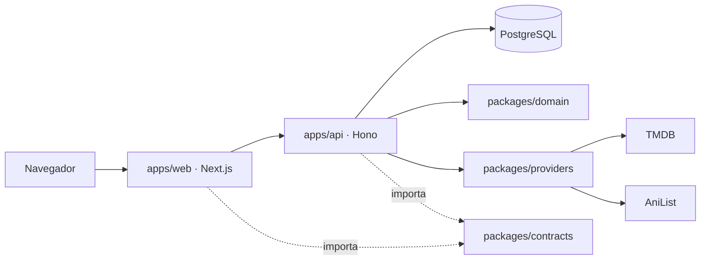

# Watchlog — Especificación del proyecto

Oct 19, 2026 · Diego Carreon

## Visión y alcance

Watchlog (nombre provisional) es una webapp personal para registrar películas, series y anime vistos, calificarlos y recibir recomendaciones basadas en esos gustos. Empieza para un usuario y unos pocos amigos, pero el modelo de datos es multiusuario desde el día uno para poder abrirse después sin migraciones dolorosas.

**Objetivos**

- Registrar en menos de 10 segundos algo visto: buscar, elegir, calificar, guardar.
- Un solo catálogo unificado para películas, series y anime, con pósters y metadatos automáticos.
- Recomendaciones explicables ("porque te gustó X"), no una caja negra.
- Un repositorio con calidad de portafolio: tipado estricto, tests, CI, Docker, documentación y despliegue reproducible.

**No-objetivos (por ahora)**

- Streaming o enlaces a contenido no oficial.
- Uso comercial: las APIs de datos son gratuitas solo para uso no comercial (ver Fuentes de datos).
- App móvil nativa; la web será responsive e instalable como PWA más adelante.

## Funcionalidades por fase

El MVP es el registro con calificaciones; las recomendaciones llegan en la v1, cuando ya hay datos tuyos para alimentarlas.

| Fase | Funcionalidad | Detalle |
| --- | --- | --- |
| MVP | Login | Email + contraseña y Google/GitHub; acceso por invitación para amigos |
| MVP | Búsqueda unificada | Un buscador que consulta TMDB (películas y series) y AniList (anime) a la vez |
| MVP | Registro de visto | Estado: Pendiente, Viendo, Terminado, Abandonado; fecha de visionado; re-visionados |
| MVP | Calificación | Escala 1–10 con medios puntos, reseña corta opcional, etiquetas propias |
| MVP | Progreso de series/anime | Temporada y episodio actual; marcar episodios vistos |
| MVP | Biblioteca | Grid y lista con filtros (tipo, estado, género, año, nota) y orden |
| MVP | Ficha de título | Póster, sinopsis, reparto, géneros, dónde verlo (proveedores de TMDB) |
| v1 | Recomendaciones | Feed "Para ti" con explicación por cada sugerencia |
| v1 | Estadísticas | Horas vistas, géneros favoritos, notas promedio, actividad por mes |
| v1 | Importar historial | CSV de Letterboxd, lista de AniList/MyAnimeList, export de Trakt |
| v1 | Watchlist inteligente | Ordenar pendientes por afinidad predicha |
| Futuro | Social | Ver lo que ven tus amigos, listas compartidas, "match" para elegir qué ver juntos |
| Futuro | PWA y notificaciones | Avisos de nuevos episodios de lo que estás viendo |
| Futuro | Recomendador v2 | Filtrado colaborativo con datos de varios usuarios y embeddings |

## Stack técnico y arquitectura

Un monorepo TypeScript con dos apps (frontend Next.js y backend Hono) sobre PostgreSQL, y la lógica compartida en paquetes. Es suficiente para miles de usuarios; ir más allá, a microservicios, no aportaría nada a esta escala.

| Capa | Elección | Por qué |
| --- | --- | --- |
| Monorepo | pnpm workspaces + Turborepo | Builds y tests incrementales; un solo lockfile y una sola CI |
| Frontend | Next.js 16 (App Router), React Server Components | Estándar actual; 16.2.x es la línea estable y requiere Node 20+ |
| Backend | Hono sobre Node | Ligero, rápido, tipado de extremo a extremo con su RPC; corre igual en Docker o en Vercel |
| Lenguaje | TypeScript en modo `strict` | Tipos compartidos front ↔ back vía `packages/contracts` |
| Estilos y UI | Tailwind CSS v4 + shadcn/ui | Componentes accesibles que copias al repo y se rediseñan |
| Base de datos | PostgreSQL 16 | Relacional, JSONB para metadatos, pgvector para el recomendador futuro |
| ORM | Prisma | Migraciones versionadas y cliente tipado |
| Autenticación | Better Auth (en `apps/api`) | Auth.js se unió a Better Auth en sept. 2025 y recomienda Better Auth para proyectos nuevos; guarda en tu Postgres y se integra con Hono |
| Validación | Zod | Un esquema por endpoint, compartido por ambas apps |
| Datos en cliente | TanStack Query sobre el cliente RPC | Caché, estados de carga y revalidación en el front |
| Tests | Vitest + Testing Library; Playwright para E2E | Unit, integración y flujos completos |
| Calidad | ESLint, Prettier, Husky + lint-staged, commitlint | Convenciones forzadas en cada commit |
| Tareas programadas | Vercel Cron (nube) / servicio cron del compose (local) | Llaman a `/cron/*` de la API para refrescar metadatos y recalcular recomendaciones |

**Decisiones de arquitectura clave**

- **Frontera front/back explícita**: `apps/web` solo pinta y llama a la API; toda regla de negocio, acceso a datos y llamada externa vive en `apps/api` y en los paquetes.
- **Capa de proveedores**: TMDB y AniList se esconden tras una interfaz común `MediaProvider` (`search`, `getDetails`, `getRecommendations`) en `packages/providers`. Añadir otra fuente (p. ej. MyAnimeList) es un archivo nuevo.
- **Caché local de títulos**: cada título que alguien registra se guarda en la tabla `Title` con sus metadatos normalizados. La API lee de Postgres, no de la API externa, lo que evita límites de tasa y hace la app rápida.
- **Lógica de dominio pura**: el recomendador y las estadísticas viven en `packages/domain` como funciones puras, sin Hono ni Prisma, para testearlas fácilmente.
- **Next.js 16 renombró `middleware.ts` a `proxy.ts`**: ahí se redirige a `/login` si no hay sesión. Muchos ejemplos de internet usan el nombre viejo.



El navegador solo habla con `web`; `web` solo habla con `api` a través del contrato compartido; y solo la capa de proveedores sale a TMDB y AniList.

## Fuentes de datos externas

TMDB cubre películas y series y AniList cubre anime; ambas son gratuitas para un proyecto personal no comercial.

| Fuente | Cubre | Acceso | Límites y condiciones |
| --- | --- | --- | --- |
| [TMDB](https://developer.themoviedb.org/docs/getting-started) | Películas, series, reparto, proveedores de streaming, recomendaciones | REST con token Bearer (API Read Access Token) | Gratis para uso no comercial con atribución (logo + aviso de que no está respaldado por TMDB); no cachear datos más de 6 meses |
| [AniList](https://docs.anilist.co/) | Anime (y manga), estudios, tags, recomendaciones de la comunidad | GraphQL público en graphql.anilist.co, sin clave para lectura | Normalmente 90 peticiones/min, hoy degradado a 30/min; puede devolver contenido adulto, hay que filtrarlo |

**Reglas para la implementación**

- Todas las llamadas externas pasan por la API; la clave de TMDB nunca llega al navegador.
- Cliente HTTP con reintentos y backoff ante 429, respetando la cabecera `Retry-After`.
- Caché en dos niveles: respuestas de búsqueda en memoria en la API unos minutos; títulos registrados en la tabla `Title`, refrescados por un cron cada 30 días (por debajo del máximo de 6 meses de TMDB).
- Pie de página con el logo de TMDB y el aviso de atribución exigido; crédito a AniList en la ficha de anime.
- Anime en ambos catálogos: muchos animes también existen en TMDB como serie. La búsqueda debe deduplicar mostrando la versión de AniList para anime (mejores metadatos) y guardar el ID de TMDB como referencia cruzada cuando exista.
- Filtrar `isAdult` en AniList y `adult` en TMDB por defecto.

## Modelo de datos

Cinco tablas propias sostienen todo: `Title` (catálogo cacheado), `LibraryEntry` (tu relación con un título), `Viewing` (cada vez que lo viste), `Recommendation` (sugerencias precalculadas) e `Invite`. Las tablas de usuario y sesión las genera Better Auth.

```prisma
enum MediaType { MOVIE SERIES ANIME }
enum Source    { TMDB ANILIST }
enum Status    { PLANNED WATCHING COMPLETED DROPPED ON_HOLD }

// User, Session, Account, Verification: generados por Better Auth

model Title {
  id            String    @id @default(cuid())
  source        Source
  externalId    String                 // id en TMDB o AniList
  tmdbId        Int?                   // referencia cruzada para anime
  type          MediaType
  title         String
  originalTitle String?
  year          Int?
  posterPath    String?
  backdropPath  String?
  overview      String?
  genres        String[]
  tags          String[]               // keywords TMDB / tags AniList
  people        String[]               // director, creadores, estudio
  runtimeMin    Int?                   // película o duración por episodio
  episodes      Int?
  seasons       Int?
  raw           Json                   // respuesta normalizada completa
  fetchedAt     DateTime
  entries       LibraryEntry[]
  @@unique([source, externalId])
  @@index([type])
}

model LibraryEntry {
  id             String    @id @default(cuid())
  userId         String
  titleId        String
  status         Status
  rating         Decimal?  @db.Decimal(3, 1)   // 1.0 – 10.0
  review         String?
  favorite       Boolean   @default(false)
  userTags       String[]
  currentSeason  Int?
  currentEpisode Int?
  startedAt      DateTime?
  finishedAt     DateTime?
  createdAt      DateTime  @default(now())
  updatedAt      DateTime  @updatedAt
  title          Title     @relation(fields: [titleId], references: [id])
  viewings       Viewing[]
  @@unique([userId, titleId])
  @@index([userId, status])
}

model Viewing {
  id        String       @id @default(cuid())
  entryId   String
  watchedOn DateTime
  note      String?
  entry     LibraryEntry @relation(fields: [entryId], references: [id], onDelete: Cascade)
}

model Recommendation {
  id          String   @id @default(cuid())
  userId      String
  titleId     String
  score       Float
  reasons     Json     // [{ kind: "similar_to", titleId, weight }, ...]
  dismissed   Boolean  @default(false)
  generatedAt DateTime
  @@unique([userId, titleId])
  @@index([userId, score])
}

model Invite {
  id        String    @id @default(cuid())
  code      String    @unique
  createdBy String
  usedBy    String?
  expiresAt DateTime
}
```

Notas: la nota es `Decimal(3,1)` para admitir medios puntos sin errores de coma flotante. `raw` guarda la respuesta normalizada para no volver a pedirla. Las tablas de amistad y listas compartidas se añaden en la fase Futuro.

## Motor de recomendaciones

Un recomendador híbrido basado en contenido funciona bien con un solo usuario y explica cada sugerencia. Con unas 20 calificaciones ya da resultados útiles.

**1. Perfil de gustos.** Cada título se describe con rasgos: géneros, tags, personas (director, estudio), tipo y década. Las notas se centran en la media del usuario, así un 6 cuando suele poner 8 cuenta como negativo. El perfil es la suma ponderada de los rasgos de lo calificado, con un peso tipo TF-IDF para que rasgos muy comunes ("Drama") pesen menos que rasgos distintivos ("Studio Trigger", "Denis Villeneuve").

**2. Candidatos.** De los títulos mejor calificados se piden las recomendaciones y similares de TMDB y las recomendaciones de la comunidad de AniList, más tendencias de los géneros favoritos. Se descarta todo lo que ya está en la biblioteca.

**3. Puntuación.** Cada candidato recibe:

```
score(c) = 0.6 · cos(perfil, c) + 0.3 · señal(c) + 0.1 · calidad(c) − penalizaciones(c)
```

Donde señal = cuántos favoritos lo sugieren, calidad = nota media y popularidad en escala logarítmica, y penalizaciones = descartado por el usuario o fuera de sus filtros. Los pesos son configurables.

**4. Diversidad.** Un reordenamiento MMR evita que el top 20 sean diez secuelas de lo mismo, y mezcla películas, series y anime según la proporción de consumo.

**5. Explicación.** Cada recomendación guarda sus razones ("Porque calificaste Frieren con 9.5", "Comparte director con Arrival") y la UI las muestra.

**Cuándo corre:** cada noche por cron y, con un retraso de unos minutos, después de calificar algo. Los resultados se guardan en `Recommendation`, así la página carga al instante.

**Arranque en frío:** un onboarding que pide calificar 10–15 títulos populares o importar el historial de Letterboxd o AniList.

**Evolución (v2):** con varios usuarios activos se añade filtrado colaborativo y embeddings de las sinopsis en pgvector.

**Evaluación:** un script offline oculta el 20% de las calificaciones altas y mide si aparecen en el top 20 (precision@20). Cada cambio al algoritmo se valida con números.

## Estructura del repositorio y estándares

Un monorepo con frontend y backend separados: `apps/web` (Next.js, solo interfaz) y `apps/api` (Hono, la API REST con auth y cron), más paquetes compartidos que ambos importan. Lo gestionan pnpm workspaces y Turborepo, que construye y testea solo lo que cambió.

**Por qué separarlos:** la frontera queda explícita, la API podrá servir a una app móvil en el futuro y el repo muestra ambos lados bien diseñados. El costo es moderado: dos apps que desplegar y un contrato que mantener, resuelto con el paquete `contracts` compartido.

**Cómo hablan:** Next.js reenvía `/api/*` a la API con un rewrite, así navegador, cookies de sesión y API comparten dominio y no hay problemas de CORS. El cliente de `apps/web` está tipado con el RPC de Hono, de modo que un cambio en la API rompe el build del front en vez de fallar en producción.

```text
watchlog/
├── apps/
│   ├── web/                      # FRONTEND · Next.js 16
│   │   ├── src/app/              # rutas: (auth)/login, (app)/library,
│   │   │                         #   (app)/title/[id], (app)/for-you, (app)/stats
│   │   ├── src/components/       # features/: TitleCard, RatingInput, SearchBar...
│   │   ├── src/lib/api-client.ts # cliente tipado (Hono RPC)
│   │   ├── src/proxy.ts          # redirige a /login si no hay sesión
│   │   ├── tests/e2e/            # Playwright
│   │   └── Dockerfile
│   └── api/                      # BACKEND · Hono sobre Node
│       ├── src/routes/           # library, titles, search, recommendations, stats, cron
│       ├── src/services/         # casos de uso: addToLibrary, rate, importLetterboxd...
│       ├── src/auth.ts           # Better Auth
│       ├── src/env.ts            # variables validadas con Zod
│       ├── tests/                # integración contra Postgres de test
│       └── Dockerfile
├── packages/
│   ├── contracts/                # esquemas Zod y tipos compartidos front ↔ back
│   ├── db/                       # Prisma: schema, migraciones, seed, cliente
│   ├── domain/                   # recomendador y estadísticas (funciones puras)
│   ├── providers/                # MediaProvider, clientes TMDB y AniList
│   ├── ui/                       # shadcn/ui + tokens de diseño
│   └── config/                   # tsconfig, eslint y prettier base
├── docs/
│   ├── SPEC.md · adr/ · design/
├── scripts/eval-recommender.ts
├── .github/workflows/ci.yml      # lint, typecheck, test, build, e2e (vía Turborepo)
├── docker-compose.yml            # web + api + db + cron
├── turbo.json · pnpm-workspace.yaml · .env.example
├── CLAUDE.md · CONTRIBUTING.md · LICENSE (MIT) · README.md
```

Regla de dependencias: `web` solo importa `contracts` y `ui`; nunca `db`, `providers` ni `domain`.

**Estándares**

- Rama `main` protegida: solo entra por pull request con la CI en verde.
- Commits con Conventional Commits (`feat(web):`, `fix(api):`, `chore:`) y versionado automático con release-please y CHANGELOG generado.
- Variables de entorno validadas al arrancar con Zod en cada app; si falta una, la app no inicia y dice cuál.
- La regla de dependencias entre paquetes se fuerza con ESLint (`no-restricted-imports`) o dependency-cruiser en la CI.
- Cobertura mínima del 80% en `packages/domain`, `packages/providers` y `apps/api/src/services`; la UI se cubre con E2E de los flujos críticos (registrar, calificar, ver recomendaciones).
- APIs externas simuladas en tests con MSW; nunca se llama a TMDB ni AniList desde la CI.
- README con capturas, badges de CI, diagrama de arquitectura, cómo correrlo en local y demo en vivo.
- Un ADR corto por cada decisión importante (por qué monorepo, por qué Hono, por qué Better Auth, por qué recomendador basado en contenido).

## Diseño

Los archivos de diseño de la UI (tokens, mockups de pantallas y componentes) viven en `docs/design/`. Son la fuente de verdad visual: los tokens se traducen a variables CSS en `packages/ui` y los componentes se construyen siguiendo los mockups. Si algo no está diseñado, se resuelve con el mismo sistema de tokens, sin inventar estilos nuevos.

## Despliegue

Docker Compose levanta todo en local (web, api, db y cron); en la nube, `web` y `api` son dos proyectos de Vercel apuntando al mismo repo, con Postgres gestionado (Neon o Supabase). Turborepo detecta qué app cambió y solo redespliega esa.

| Entorno | Frontend (`web`) | Backend (`api`) | Base de datos | Tareas programadas |
| --- | --- | --- | --- | --- |
| Desarrollo | `pnpm dev` (Turborepo levanta ambas apps) | Misma orden | `docker compose up db` | Manual con `pnpm --filter api cron:recs` |
| Self-hosted | Contenedor `web` | Contenedor `api` | Contenedor Postgres con volumen | Servicio `cron` del compose |
| Producción | Proyecto Vercel `watchlog-web` | Proyecto Vercel `watchlog-api` (Hono) o contenedor en Railway/Fly.io | Neon o Supabase, plan gratuito | Vercel Cron llamando a `/cron/*` con secreto |
| Previews | URL por pull request | URL por pull request | Rama de Neon por PR (opcional) | Desactivadas |

**Detalles**

- Un `Dockerfile` multi-stage por app, usando `turbo prune` para copiar solo los paquetes que esa app necesita; imágenes pequeñas y usuario no-root.
- `web` reenvía `/api/*` a la URL de la API (`API_URL`) con un rewrite: un solo dominio para el navegador y cookies de sesión sin CORS.
- Las migraciones corren en el despliegue de `api` con `prisma migrate deploy`, nunca `migrate dev` en producción.
- `/health` en la API comprueba la conexión a la base de datos, para Docker y monitoreo.
- Secretos solo en variables de entorno de `api`: `DATABASE_URL`, `BETTER_AUTH_SECRET`, `TMDB_READ_TOKEN`, `CRON_SECRET`, credenciales OAuth. `web` solo necesita `API_URL`.
- Errores en producción con Sentry en ambas apps desde la v1.
- El plan gratuito de Vercel (Hobby) es para uso no comercial, lo cual encaja con las condiciones de TMDB.

## Plan de trabajo por fases

Una fase a la vez, cada una en su propia rama y pull request.

1. **Fundaciones**: monorepo con pnpm workspaces y Turborepo; `apps/web` (Next.js 16 + Tailwind + shadcn/ui en `packages/ui`) y `apps/api` (Hono) con un endpoint `/health`; `packages/config` compartido; tokens de diseño base en `packages/ui` a partir de `docs/design/`; ESLint con la regla de dependencias, Prettier, Husky, commitlint, Vitest, Playwright; Docker Compose; CI en GitHub Actions; README y `.env.example`.
2. **Datos y auth**: `packages/db` con el esquema Prisma, migración inicial y seed; Better Auth en `apps/api` con email y GitHub/Google; registro solo por invitación; rewrite `/api/*` en `web` y `proxy.ts` protegiendo `(app)`.
3. **Contrato y proveedores**: `packages/contracts` con los esquemas Zod de cada endpoint; `packages/providers` con `MediaProvider`, clientes TMDB y AniList, reintentos y tests con MSW; endpoint de búsqueda unificada con deduplicación de anime.
4. **Registro (API + UI)**: endpoints y pantallas para añadir a biblioteca, estados, calificación con medios puntos, reseña, progreso de episodios y re-visionados.
5. **Biblioteca y ficha**: vistas grid/lista, filtros y orden, ficha con proveedores de streaming, atribución TMDB.
6. **Pulido del diseño**: revisar todas las pantallas contra `docs/design/`, estados vacíos, carga y error, responsive y accesibilidad.
7. **Recomendaciones v1**: `packages/domain` (perfil, candidatos, puntuación, MMR, razones), endpoint y cron en la API, página Para ti, script de evaluación.
8. **Estadísticas e importación**: dashboard de estadísticas, importadores de Letterboxd y AniList.
9. **Producción**: Dockerfiles con `turbo prune`, dos proyectos en Vercel + Neon, cron, Sentry, dominio.

## Fuentes

- [Next.js 16.2.x estable (junio 2026)](https://abhs.in/blog/nextjs-current-version-march-2026-stable-release-whats-new)
- [Auth.js se une a Better Auth](https://www.turbostarter.dev/blog/better-auth-vs-clerk-vs-nextauth-vs-supabase-auth)
- [Next.js 16: middleware.ts pasa a proxy.ts](https://blog.logrocket.com/best-auth-library-nextjs-2026/)
- [TMDB: clave, atribución y caché](https://apidog.com/blog/tmdb-api-key/)
- [AniList: límites de tasa](https://docs.anilist.co/guide/rate-limiting)
- [AniList: estabilidad y contenido adulto](https://docs.anilist.co/guide/considerations)
